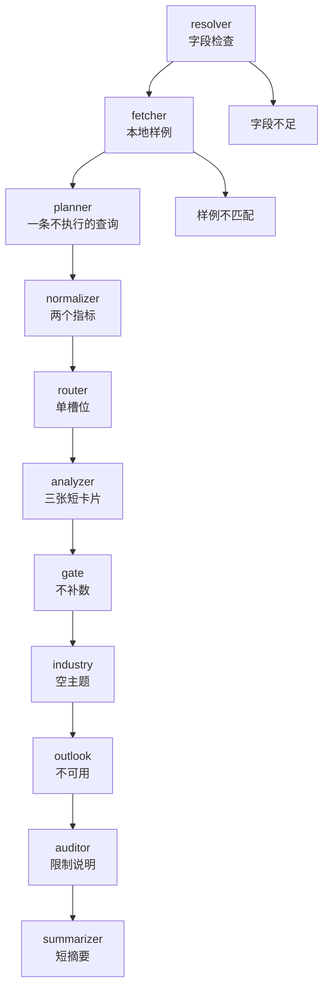

# 模块结构

审阅版按阶段拆开，方便查看链路。拆开不等于带入商业效果。

对应目录：

- `stages/`：每个阶段一个模块
- `contracts/`：状态机、事件和结果组装
- `api/`：本机任务接口和降级清单
- `prompts/`：短提示词
- `fixtures/`：唯一数据样例

状态顺序是 `INIT -> RESOLVED -> FETCHED -> PLANNED -> ANALYZED -> GATED -> INDUSTRY -> OUTLOOK -> REVIEWED -> SUMMARIZED -> DELIVERED`。非法跳转会直接失败。
